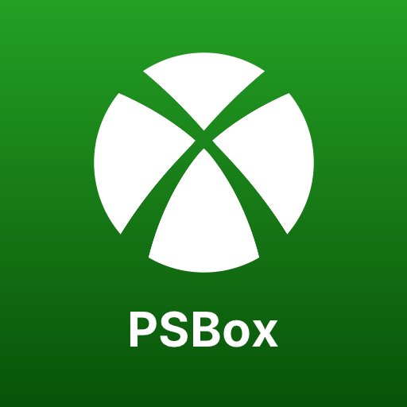

<p align="center">
  
</p>

<h1 align="center">PSBox Cloud Gaming — GitHub Pages &amp; Browser Edition</h1>
<p align="center"><em>Xbox Cloud Gaming &amp; Remote Play in your browser, built with PSBox Cloud Gaming's official assets and protocol.</em></p>

## Live GitHub Pages Site

This repository includes a GitHub Actions workflow (`.github/workflows/deploy-pages.yml`) that automatically builds the static web app (`npm run build:pages`) and deploys it to **GitHub Pages** (`https://robloxgamee1231-ctrl.github.io/XBOX-CLOUD-GAMING-/`).

### Enabling GitHub Pages
1. Merge the pull request into `main`.
2. Open **Settings → Pages** in your GitHub repository and set **Source** to **GitHub Actions**.
3. The workflow builds `dist/` and publishes your site automatically.

### Signing in with Microsoft Account on GitHub Pages
Microsoft's OAuth and Xbox Live APIs (`login.live.com`, `*.xboxlive.com`) do not send browser CORS headers to third-party origins like `github.io`. You have two options:

1. **Free Cloudflare Worker Relay (for GitHub Pages):**
   - Create a free Cloudflare Worker and paste the contents of `cloudflare-worker/worker.js`.
   - Paste your `https://<name>.workers.dev` URL into the **Relay URL** field on the PSBox sign-in screen.
   - Sign in with your real Microsoft Account via `microsoft.com/link` right from GitHub Pages.
2. **Demo Mode (Zero Setup):**
   - Click **Launch Browser Demo Mode** on the sign-in screen to explore the Game Pass catalog, My Games, My Consoles, Controller Tester, and interactive 60 FPS stream simulator immediately in your browser.

## Running Locally (Built-in Express Proxy + Live Microsoft Sign-In)

If you run locally with Node.js, the included Express backend handles Microsoft Account Device-Code Sign-In, Xbox Live/XSTS token exchange, and xCloud signaling automatically with zero external relay:

```bash
npm install
npm run dev
```

Open `http://localhost:3000` in your browser.

For production:

```bash
npm run build
npm start
```

## Features

- **Official PSBox Assets**: Uses `icon0.png`, `pic1.png`, `guitar.svg`, and the `Inter` font family from [RafaelNGP/psbox-cloud-gaming](https://github.com/RafaelNGP/psbox-cloud-gaming).
- **Microsoft Account Sign-In (`login.live.com`)**: Official OAuth2 Device-Code flow (`client_id: 000000004c20a908`) with QR code, one-click code copy, automatic polling, and encrypted session persistence.
- **Game Pass &amp; My Games**: Hero spotlight, *Jump back in*, *Most popular*, *Recently added*, *Free to play*, *Wishlist*, *Search*, and *My consoles (Remote Play)*.
- **WebRTC Stream Player**: Real `RTCPeerConnection` + `chatV1` / `controlV1` / `1.0` (unordered binary input) / `messageV1` data channels, up to 1440p, telemetry HUD, sharpness presets, virtual keyboard modal, mouse/keyboard pointer lock, and on-screen virtual gamepad.
- **Controller Support**: DualSense, DualShock 4, and Xbox controllers via the Browser Gamepad API with dual-rumble vibration and a live Stick Deadzone &amp; Trigger Tester.

## License

GPL-3.0-or-later (matching upstream [PSBox Cloud Gaming](https://github.com/RafaelNGP/psbox-cloud-gaming); see `LICENSE` and `THIRD_PARTY_NOTICES.md`).
